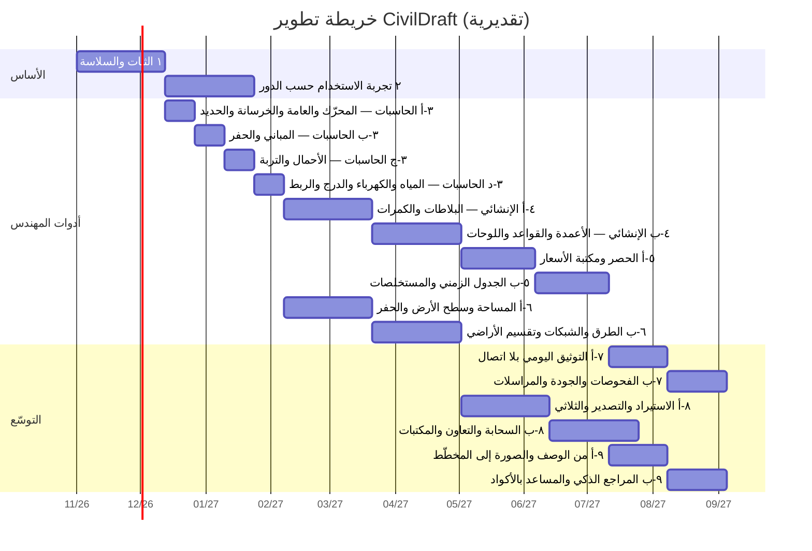

# خطة تطوير CivilDraft — من مرسمة معمارية إلى «حقيبة المهندس المدني» الكاملة

> **مبنيّة على:** فحص الحزمة المرفوعة `civildraft-phase-F` (الإصدار 2.2.0، بعد المرحلة F من قشرة الهاتف).
> **آخر تحديث:** المرحلة ١ نُفِّذت في 2.3.0، والمرحلة ٢ أُغلقت في 2.6.0، والجزء ٣-أ نُفِّذ في 2.7.0، والجزء ٣-ب في 2.8.0 وأُغلق بإصلاح 2.8.1 (والكود المعتمد BS 8110)، والجزء ٣-ج في 2.9.0 وأُغلق بتثبيت BS 8110 كوداً وحيداً للمشروع في 2.9.1. حالةُ كلٍّ تحت عنوانها أدناه.
> **تقسيم المراحل:** المرحلة ٣ مقسَّمة إلى أربعة أجزاء (أ / ب / ج / د)، والمراحل ٤–٩ مقسَّمة كلٌّ منها إلى جزأين (أ / ب)، لكل جزء مخرجاته ومدّته ومعيار قبوله، ويُسلَّم وينشر مستقلاً. مجموع مُدد الأجزاء = مدة المرحلة الأصلية. معايير القبول الجديدة التي أُضيفت لتغطية الجزء الذي لم يكن له معيار موسومة بـ«(معيار مقترح)».
> **المدة التقديرية الإجمالية:** ١٢–١٥ شهراً لفريقٍ من مطوّرَين ومهندس مدني مراجع. كلّ مرحلةٍ تُسلَّم مستقلّةً وتُنشَر وحدها.

---

## ١. أين يقف التطبيق اليوم

### نقاط القوة (تُبنى عليها الخطة ولا تُهدَم)
| المجال | الموجود فعلاً |
|---|---|
| **النواة** | ≈ ٥٤ ألف سطر بلا أي مكتبة خارجية، ووحدات ES خام و`<canvas>`، والتخزين بالمليمتر والإدخال بالمتر، وواجهة عربية RTL كاملة |
| **الجودة** | ≈ ٤١ ألف سطر اختبارات و٢٥٧ مجموعة خضراء، ومُدقِّق موحّد يمنع البيانات الفاسدة، وعقود واضحة («لا يتحرّك إحداثيٌّ إلّا بأمرك») |
| **الرسم** | ١٨ أداة رسم و٢٥ أداة تعديل و٢٢ أداة تأشير وأبعاد، وأقواس حقيقية (bulge)، وصورة مرجعية بالمعايرة |
| **العناصر** | ٤٤ عنصر خدمات: أثاث وصحّي ومطبخ وكهرباء وتكييف، ودرج (مستقيم وL وU)، وأعمدة وكمرات وقواعد وبلاطات وسقف |
| **العروض** | طوابق متعددة، ومقطع، وواجهة، وعرض ثلاثي أكسونومتري |
| **الإخراج** | DXF R2000 وPDF وSVG وPNG، وأوراق متعددة بمنافذ ومقاييس، وجدول كميات (BOQ)، وحصر لكل طابق، وتسعير (ر.س + ضريبة ١٥٪)، وتقرير عميل، وCSV |
| **الذكاء** | توليد عناصر من وصف عربي محلياً بلا اتصال، ومساعد اختياري متوافق مع OpenAI، وفاحص اشتراطات إرشادي |
| **التعليم** | دليل تفاعلي، ودروس، وشهادة، وجولات تعريفية |
| **المنصّات** | PWA يعمل بلا إنترنت، وتطبيق أندرويد عبر Capacitor، وقشرة هاتف مستقلّة |

### الفجوات (ما يحتاجه المهندس المدني ولا يوجد)
1. **لا تصميم إنشائي:** العناصر الإنشائية تُرسَم وتُحصَر لكنها لا تُصمَّم (لا أحمال ولا تسليح ولا تحقق من كود).
2. **لا تفريد للحديد (BBS):** وهو أهمّ مستند تنفيذي في الموقع.
3. **لا مساحة ولا طرق:** لا نقاط مساحية ولا مناسيب أرض ولا كنتور ولا حجوم حفر وردم.
4. **لا إدارة تنفيذ:** لا جدول زمني، ولا مستخلصات، ولا تقارير يومية.
5. **لا حاسبات هندسية سريعة:** المهندس يفتح تطبيقات أخرى لحساب خلطة أو وزن حديد أو عدد بلوك.
6. **تكامل محدود:** لا DWG ولا IFC/BIM ولا مزامنة سحابية ولا تعاون.
7. **أداء غير مكتمل:** حزمة الإقلاع ≈ ٤٠٣ ك.ب (الهدف < ٤٠٠)، والتجميع بـ esbuild مؤجَّل، وبوابة الهاتف الحقيقي للأندرويد لم تُغلَق بعد.
8. **عرض ثلاثي بسيط:** إسقاط أكسونومتري ثابت بلا WebGL ولا تجوّل ولا مواد.

---

## ٢. مبادئ التطوير (تسري على كل المراحل)

1. **احترام العقود القائمة:** كل أداة جديدة تمرّ بالمُدقِّق الموحّد وبالتراجع/الإعادة وبنطاق «المرئي والقابل للطباعة» نفسه في BOQ والتصدير.
2. **كل حساب هندسي «يخبر ولا يقرّر»:** يعرض المعادلة والمدخلات والمرجع (بند الكود)، ويُكتَب بوضوح أن **النتيجة إرشادية وتتطلّب اعتماد مهندس مرخّص**.
3. **كودُ المشروع BS 8110:** القرار محسوم (v2.8.0): BS 8110-1:1997 (مع A3:2007) هو كودُ الحسابات والتصميم الإنشائي في كل المراحل، ويُطبَع في كل نتيجة. تبقى طبقة «مِلفّ الكود» منفصلةً (تُقرَأ منها المعاملات ولا تُكتَب داخل الحسابات) ليسهل إضافة كودٍ آخر لاحقاً (ACI 318 / SBC 304 / ECP 203 / Eurocode 2) دون لمس الحسابات. أمّا الأكواد الأخرى في «معلومات المشروع» فتسميةٌ للعنوان فقط، ولوحة الحاسبات تنبّه عند اختيارها (v2.9.1).
4. **بلا اتصال أولاً:** كل أداة حسابية تعمل بلا إنترنت؛ السحابة إضافة لا شرط.
5. **الهاتف مواطن من الدرجة الأولى:** كل ميزة جديدة تُسلَّم بقشرتَي سطح المكتب والهاتف معاً.
6. **بوابة لكل مرحلة ولكل جزء:** لا تُغلَق مرحلة إلا باختبارات خضراء + اختبار ذهبي للمخرجات + مراجعة مهندس + فحص على هاتف حقيقي.
7. **ميزانية أداء ثابتة:** الإقلاع < ٣٥٠ ك.ب مضغوطة، وأول رسم على هاتف متوسط < ٢ ثانية، والأدوات الثقيلة تُحمَّل عند الطلب.

---

## ٣. خريطة المراحل

| # | المرحلة | المدة | الأولوية | القيمة للمستخدم |
|---|---|---|---|---|
| ١ | الثبات والسلاسة | ٦ أسابيع | 🔴 حرجة | تطبيق أسرع وأخفّ وجاهز للنشر |
| ٢ | تجربة الاستخدام حسب الدور | ٦ أسابيع | 🔴 حرجة | كل مهندس يرى أدواته فقط |
| ٣-أ | الحاسبات — المحرّك والعامة والخرسانة والحديد | أسبوعان | 🔴 حرجة (مكسب سريع) | محرّك حاسبات و١٢ حاسبة يومية |
| ٣-ب | الحاسبات — المباني والحفر | أسبوعان | 🔴 حرجة | ٩ حاسبات كميات وتشطيبات (المجموع ٢١) |
| ٣-ج | الحاسبات — الأحمال والتربة | أسبوعان | 🔴 حرجة | ٩ حاسبات تغذّي التصميم الإنشائي (المجموع ٣٠) |
| ٣-د | الحاسبات — المياه والكهرباء والدرج والربط بالمخطّط | أسبوعان | 🔴 حرجة | ٤٠ حاسبة مربوطة بالمخطّط |
| ٤-أ | الإنشائي — الأساس والبلاطات والكمرات | ٦ أسابيع | 🟠 عالية | تصميم وتسليح وتفريد للعناصر الأفقية |
| ٤-ب | الإنشائي — الأعمدة والقواعد واللوحات | ٦ أسابيع | 🟠 عالية | لوحات إنشائية وBBS كاملة |
| ٥-أ | الحصر الشامل ومكتبة الأسعار | ٥ أسابيع | 🟠 عالية | حصر مربوط بالنموذج وتسعير قابل للتخصيص |
| ٥-ب | الجدول الزمني والمستخلصات وأوامر التغيير | ٥ أسابيع | 🟠 عالية | مسار حرج ومستخلصات وفروق التغيير |
| ٦-أ | المساحة وسطح الأرض والحفر والردم | ٦ أسابيع | 🟡 متوسطة | نقاط وكنتور وحجوم حفر وردم |
| ٦-ب | تقسيم الأراضي والطرق والشبكات | ٦ أسابيع | 🟡 متوسطة | طرق وشبكات مياه وصرف |
| ٧-أ | التوثيق اليومي والعمل بلا اتصال | ٤ أسابيع | 🟡 متوسطة | تقرير يومي وصور وملاحظات من الهاتف |
| ٧-ب | الفحوصات والجودة والمراسلات | ٤ أسابيع | 🟡 متوسطة | قوائم فحص وسجل اختبارات وRFI |
| ٨-أ | الاستيراد والتصدير والعرض الثلاثي | ٦ أسابيع | 🟡 متوسطة | DWG وIFC وWebGL |
| ٨-ب | السحابة والتعاون والمكتبات | ٦ أسابيع | 🟡 متوسطة | مزامنة ومشاركة وتعليقات |
| ٩-أ | من الوصف والصورة إلى المخطّط | ٤ أسابيع | 🟢 تحسينية | مخطّط مبدئي وحصر من ملف خارجي |
| ٩-ب | المراجع الذكي والمساعد بالأكواد | ٤ أسابيع | 🟢 تحسينية | مراجعة ذكية وإجابات بالبند والمصدر |

> المرحلتان ٣ و٦ يمكن أن تسيرا بالتوازي مع ٤ إن توفّر مطوّر ثالث.

---

## ٤. تفصيل المراحل

### المرحلة ١ — الثبات والسلاسة (٦ أسابيع)
**الهدف:** إغلاق الديون المفتوحة قبل إضافة أي ميزة كبيرة، وجعل التطبيق سلساً على أضعف هاتف مستهدف.

**المخرجات:**
- **التجميع والإنتاج:** تفعيل `build:bundle` بـ esbuild في CI (لا في بيئة المستخدم) مع الإبقاء على الوحدات الخام للتطوير، وتقسيم الحزمة: نواة + رسم عند الإقلاع، والباقي (ثلاثي، تسعير، أوراق، تصدير PDF) عند الطلب.
- **الأداء:**
  - نقل الحسابات الثقيلة (BOQ، النموذج الثلاثي، التحقق، التصدير) إلى **Web Worker** حتى لا تتجمّد الواجهة.
  - `OffscreenCanvas` لطبقة المخطّط المحفوظة على المتصفحات الداعمة.
  - فهرس مكاني (موجود في `sindex`) يُعمَّم على الالتقاط والتحديد في المشاريع الكبيرة (١٠ آلاف عنصر فأكثر).
  - قياس «أول رسم» و«زمن الاستجابة للّمس» على ٣ هواتف حقيقية (ضعيف ومتوسط وقوي).
- **الموثوقية:**
  - إغلاق بوابة أندرويد على جهاز حقيقي.
  - حسم الأسئلة المفتوحة في ملف العيوب (`S.os` و`S.pol` والتاريخ).
  - حفظ تلقائي بنسخ دوّارة (آخر ١٠ نسخ) مع استرجاع بعد الانهيار.
  - سجلّ أخطاء محلي يمكن للمستخدم إرساله بضغطة.

**معيار القبول:** الإقلاع < ٣٥٠ ك.ب · أول رسم < ٢ث على الهاتف المتوسط · مشروع بـ ١٠ آلاف عنصر يتحرك بـ ٥٠ إطاراً/ث أو أكثر · بوابة أندرويد مغلقة · السويت خضراء.

#### ✅ حالة التنفيذ — نُفِّذت في الإصدار 2.3.0 (أكتوبر ٢٠٢٦)

| البند | الحالة | التفاصيل |
|---|---|---|
| ميزانية الحجم في CI | ✅ تم | `scripts/size-budget.js` (`npm run size` / `npm run size:dist`) وخطوة «Boot size budget» في `.github/workflows/android.yml` تبني الحزمة المجمّعة وتوقف البناء عند التجاوز |
| تقسيم الحزمة: التصدير عند الطلب | ✅ تم | كُتّاب DXF/SVG/PNG/PDF/ZIP والمقطع والواجهة وPDF الكميات والتقرير لم تعد تُحمَّل عند الإقلاع، بل عند أول تصدير |
| حجم الإقلاع (gzip) | 🟡 تحسّن ولم يبلغ الهدف | المجمّع: **410 ← 398 ك.ب** (الهدف ٣٥٠). المصدر الخام: 832 ← 804. الحدّ في CI مضبوط على 405 ليمنع التراجع، ويُخفَّض مع كل تقسيم جديد |
| Web Worker للحسابات الثقيلة | 🟡 جزئي | الفاحص (≈٩٠٠ م.ث على ١٠ آلاف جدار) ينتقل إلى الخلفية للمشاريع ≥ ٣٠٠٠ عنصر، ويرجع للفحص المحلي عند أي عطل. **الكميات (≈٢٠ م.ث) لا تحتاجه**. النموذج الثلاثي والتصدير لم يُنقلا بعد |
| فهرس مكاني | ✅ كان موجوداً | `sindex` مستعمل أصلاً في الالتقاط (`osnap`). تعميمه على التحديد بالصندوق يبقى للمرحلة التالية |
| `S.os` و`S.pol` | ✅ حُسم | ثبت أن التراجع كان يقلب أنماط الالتقاط وزوايا التتبع، وأُصلح العيب مع اختبار يحرسه |
| نسخ دوّارة واسترجاع | ✅ كان موجوداً | `io/snaps.js` (حتى ١٢ لقطة، تلقائياً كل ١٠ دقائق) و`io/backup.js` (نسخة خارجية) |
| سجل أخطاء محلي | ✅ تم | `core/errlog.js` يحفظ آخر ٥٠ عطلاً على الجهاز. «انسخ سجلّ الأعطال» في قائمة التطبيق ينسخه مع الإصدار والمتصفح، ولا شيء يُرسَل تلقائياً |
| `OffscreenCanvas` | ⏸ مؤجّل | فيه مخاطرة على مسار الرسم، والقياس أولى |
| أول رسم < ٢ث، و٥٠ إطاراً/ث على الهاتف | ⏳ يحتاج جهازاً | لا يمكن قياسه في بيئة البناء |
| إغلاق بوابة أندرويد | ⏳ يحتاج جهازاً | `docs/PHASE16-ANDROID-DEVICE-GATE.md` |

**الاختبارات:** السويت كاملة خضراء (252/252 ملفاً، و`npm run test:ci` كذلك)، وفيها ملف جديد `phase1-stability.test.js` بـ٥٨ فحصاً. وصُحِّح اختباران قديمان كانا يفشلان قبل البدء (`section-poche` و`jrcopy` في node).

**ما بقي من المرحلة ١:** قياس الأداء على ٣ هواتف حقيقية، وإغلاق بوابة أندرويد، والنزول بحجم الإقلاع إلى ٣٥٠ ك.ب. أكبر الأجزاء الباقية في الإقلاع: نواة الحالة، ولوحة الخصائص، والقماش، وأدوات التعديل. وبعدها نقل النموذج الثلاثي إلى الـ Worker، وتجربة OffscreenCanvas بعد القياس.

---

### المرحلة ٢ — تجربة الاستخدام حسب الدور (٦ أسابيع)
**الهدف:** التطبيق يحوي ١٥٠ أداة تقريباً؛ المطلوب أن يرى كل مستخدم ما يحتاجه فقط دون أن يضيع.

**المخرجات:**
- **مساحات عمل حسب الدور** تُختار عند أول تشغيل وتُبدَّل في أي وقت: معماري · إنشائي · مساح/طرق · مهندس موقع · مقدّر كميات · طالب. كل مساحة تحدد تبويبات الشريط والقوالب والدروس الظاهرة (البنية جاهزة في محرّر الشريط المخصّص).
- **مركز المشروع:** شاشة بداية تعرض المشاريع الأخيرة والقوالب، ومعلومات المشروع (المالك، الموقع، رقم الرخصة، الكود المعتمد، العملة) التي تُقرأ في كل مكان: لوحة العنوان والتقارير والتسعير.
- **لوحة عنوان (Title Block) احترافية** قابلة للتخصيص، فيها شعار المكتب والتواقيع والمراجعات وجدول الإصدارات.
- **بحث موحّد ذكي:** أداة أو حاسبة أو عنصر أو إعداد أو درس، كلها من خانة واحدة (Ctrl+K)، ويفهم الأخطاء الإملائية العربية والعامية.
- **سلاسة التفاعل:** معاينة حية لكل أمر قبل التأكيد، وتلميحات سياقية بجانب المؤشر، وانتقالات ناعمة، واهتزاز خفيف على الهاتف عند الالتقاط.
- **إمكانية الوصول:** تباين كافٍ، وأحجام لمس ≥ ٤٤ بكسل، ودعم قارئ الشاشة للوحات، وتكبير الخط.
- **الواجهة الإنجليزية (اختيارية):** فصل النصوص إلى ملفات ترجمة، فيصبح التطبيق ثنائي اللغة ويُسوَّق خارج المنطقة.

**معيار القبول:** مستخدم جديد يرسم غرفة بباب وشباك ويصدّر PDF في أقل من ٣ دقائق دون مساعدة (اختبار مع ٥ مستخدمين حقيقيين).

#### ✅ حالة التنفيذ — نُفِّذت في الإصدارات 2.4.0 ← 2.6.0 (أكتوبر ٢٠٢٦)
| البند | الحالة | التفاصيل |
|---|---|---|
| مساحات العمل حسب الدور | ✅ تم | `ui/roles.js`: ستة أدوار، مرشِّحٌ فوق الشريط، القوالب والدروس مرتّبة بالدور |
| الاختيار عند أول تشغيل | ✅ تم | بطاقات الدور في الترحيب، وإلا مركز المشروع مرةً واحدة (`shouldAskRole`) |
| مركز المشروع | ✅ تم | `ui/projhub.js`: المشاريع الأخيرة (`io/recents.js`) والقوالب ومعلومات المشروع |
| لوحة عنوان احترافية | ✅ تم | شعار متّجه، تواقيع، ختم اعتماد، سجلّ مراجعات (جدول الإصدارات) |
| بحث موحّد ذكي | ✅ تم | `ui/searchcommon.js`: عامّيّ وإملائيّ، والإعدادات والأدوار والدروس في Ctrl+K |
| سلاسة التفاعل | ✅ تم | تلميح بجانب المؤشّر، اهتزاز قابل للإطفاء، انتقالات قابلة للإلغاء |
| إمكانية الوصول | ✅ تم | خط ١١٥/١٣٠٪، تباين عالٍ، لمس ≥ ٤٤ بكسل، حصر التركيز وإعلانات قارئ الشاشة |
| الواجهة الإنجليزية | 🟡 تجريبية | ٣٦٥ نصّاً، والنصّ غير المترجم يبقى عربياً |
| اختبار ٥ مستخدمين | ⏳ يحتاج أناساً | معيار القبول لا يُقاس في بيئة البناء |

**الاختبارات:** 253/253، و`phase2-roles.test.js` بـ139 فحصاً. **ما بقي:** اختبار المستخدمين الخمسة، وإكمال الترجمة، وحجم مصدر الإقلاع 825.5 ك.ب (الحدّ 820).

---

### المرحلة ٣ — الحاسبات الهندسية «حقيبة المهندس» (٨ أسابيع) ⭐ مكسب سريع
**الهدف:** أكثر ما يستعمله المهندس المدني يومياً حاسبات صغيرة. تُبنى كوحدات مستقلة خفيفة تعمل بلا مخطّط، **ويمكن ربطها بالمخطّط** (تحديد بلاطة ← حساب حديدها).

**البنية:** محرّك حاسبات واحد (مدخلات بوحدات + معادلات + مرجع + نتيجة + تصدير PDF)، فتضاف كل حاسبة جديدة بملف تعريف صغير، وتظهر تلقائياً في البحث والدليل. وكل حاسبة لها اختبار بقيم مرجعية من كتب معتمدة.

> **التقسيم:** أربعة أجزاء، مدّة كلٍّ منها أسبوعان، ويُسلَّم كل جزء وينشر مستقلاً. ٣-أ يبني المحرّك ويسلّم حاسبات العامة والخرسانة والحديد. ٣-ب يسلّم حاسبات المباني والحفر. ٣-ج يسلّم الأحمال والتربة اللتين تعتمد عليهما المرحلة ٤. ٣-د يكمل المياه والكهرباء والدرج ويربط الحاسبات بالمخطّط. **المجموع التراكمي:** ١٢ ← ٢١ ← ٣٠ ← ٤٠ حاسبة.

#### ٣-أ — المحرّك والحاسبات العامة والخرسانة والحديد (أسبوعان)
**الهدف:** محرّك حاسبات جاهز، وأول ١٢ حاسبة من أكثرها استعمالاً في الموقع والمكتب.

**المخرجات:**
- **محرّك الحاسبات:** ملف تعريف صغير لكل حاسبة (مدخلات بوحدات + معادلات + مرجع + نتيجة)، وتصدير PDF عربي، وظهور تلقائي في البحث (Ctrl+K) والدليل.
- **اختبار مرجعي لكل حاسبة:** ٣ حالات من كتب معتمدة.
- **الحاسبات:**

| المجموعة | الحاسبات |
|---|---|
| **عامة** | محوّل وحدات (طول، مساحة، حجم، قوة، ضغط، عزم)، ومساحات وحجوم الأشكال، والميول والانحدارات، والمثلثات والزوايا |
| **الخرسانة** | تصميم الخلطة (نسب وزنية/حجمية)، وكميات المواد لكل م³ (أسمنت، رمل، حصى، ماء)، وحجم الخرسانة للعناصر، وزمن فك الشدّات |
| **الحديد** | وزن الحديد بالقطر والطول، وتحويل عدد الأسياخ ↔ المساحة، وطول الوصلة والتثبيت، وتحويل التباعد |

**معيار القبول:** ١٢ حاسبة أو أكثر، ولكل واحدة ٣ حالات مرجعية مطابقة، وتصدير PDF عربي لكل حاسبة، وتعمل كلها بلا إنترنت على الهاتف. *(معيار مقترح)* حاسبة جديدة تُضاف بملف تعريف واحد فتظهر تلقائياً في البحث (Ctrl+K) والدليل دون أي تعديل في الواجهة.

#### ✅ حالة التنفيذ — نُفِّذ ٣-أ في الإصدار 2.7.0 (أكتوبر ٢٠٢٦)
| البند | الحالة | التفاصيل |
|---|---|---|
| محرّك الحاسبات | ✅ تم | `src/calc/engine.js`: تعريفٌ صغيرٌ لكل حاسبة، تحويل وحدات، أرقام عربية وفاصلة، رفضٌ صريح للحدود، خطوات بالأرقام ومرجع وتنبيه إلزامي. التعريفُ المعطوب (أو بأقلّ من ٣ حالات) لا يُسجَّل |
| الوحدات والجداول | ✅ تم | `calc/units.js` (NIST SP 811) و`calc/tables.js`: ACI 211.1 وACI 347 وACI 318-19 بالبند، تُقرأ ولا تُكتَب داخل الحسابات (بداية مِلفّ الكود) |
| ١٢ حاسبة | ✅ تم | **عامة:** محوّل الوحدات · المساحات والحجوم · الميول · المثلثات. **خرسانة:** تصميم الخلطة (ACI 211.1) · كميات المواد · حجم الخرسانة للعناصر · فكّ الشدّات (ACI 347). **حديد:** الوزن · عدد الأسياخ ↔ المساحة · التثبيت والوصلة (ACI 318-19) · التباعد |
| ٣ حالات مرجعية لكل حاسبة | ✅ تم | 42 حالة، منها مثال ACI 211.1 الملحق 1 |
| تصدير PDF عربي | ✅ تم | `calc/pdf.js` بالكاتب الموحَّد نفسه، ونسخ النتيجة نصّاً |
| ظهورٌ تلقائي في Ctrl+K والدليل | ✅ تم | `paletteEntries` و`calcLessons` تُبنيان من التعريفات؛ الاختبارُ يضيف حاسبةً تجريبية فتظهر في البحث والدليل والـPDF بلا لمس الواجهة (المعيار المقترح) |
| المداخل | ✅ تم | زرّ «حقيبة المهندس» في الشريط (حصر وتسعير)، وفي ورقة «حصر وتسعير» على الهاتف، وCtrl+K |
| بلا إنترنت | ✅ تم | كل ملفّات `calc/` في كاش العامل، والمحرّك واللوحة خارج رسم الإقلاع (يحرسه الاختبار) |
| فحصٌ على هاتف حقيقي ومراجعة مهندس | ⏳ يحتاج جهازاً وإنساناً | لا يُقاس في بيئة البناء |
**الاختبارات:** `phase3a-calc.test.js` (268 فحصاً)، ودفتر التغطية بلا مكشوفٍ جديد. **ما بقي:** فحص اللوحة على هاتف حقيقي، ومراجعة الحالات المرجعية من مهندس، وحجم مصدر الإقلاع ما زال فوق الحدّ (826 مقابل 820) من قبل ٣-أ.
#### ✅ حالة التنفيذ — نُفِّذ ٣-ب في الإصدار 2.8.0 (أكتوبر ٢٠٢٦)
| البند | الحالة | التفاصيل |
|---|---|---|
| الكود المعتمد | ✅ تم | BS 8110-1:1997 (مع A3:2007) في `calc/tables.js`، وخيار «BS 8110» في معلومات المشروع. التثبيت والوصلة وفكّ الشدّات صارا وفقه، وACI يبقى لتصميم الخلطة فقط |
| الكود في المخرجات | ✅ تم | يُطبع في النتيجة المنسوخة وPDF الحاسبة واللوحة |
| ٩ حاسبات المباني والحفر | ✅ تم | البلوك والطوب والمونة · اللياسة · الدهان · البلاط · العزل · الأسقف المستعارة · الحفر · الانتفاش والدمك · الشاحنات. المجموع 21 |
| ٣ حالات مرجعية لكل حاسبة | ✅ تم | 104 حالة مطابقة، بعضها من الحصر البريطاني والجداول المنشورة |
| الربط بالنموذج والاستيراد | ⏸ مؤجّل | الحاسبات مستقلّة عن المخطّط حتى الآن |
| فحص على هاتف ومراجعة مهندس | ⏳ يحتاج جهازاً وإنساناً | لا يُقاس في بيئة البناء |
**الاختبارات:** `phase3b-calc.test.js` (266 فحصاً) و`phase3a-calc.test.js` (414 فحصاً). **أُغلق في 2.8.1:** كان `guide.phase9b` يفشل (بحث «شرح جدار») لأن دروس الحاسبات تزاحم النتائج؛ والسويت الآن 255/255. **ما بقي:** تصميم الخلطة بطريقة DoE/BRE، وفحص هاتف حقيقي، ومراجعة مهندس.
#### ✅ حالة التنفيذ — نُفِّذ ٣-ج في الإصدار 2.9.0 (أكتوبر ٢٠٢٦)
| البند | الحالة | التفاصيل |
|---|---|---|
| ٦ حاسبات أساسية | ✅ تم | **الأحمال:** أحمال البلاطة الميتة والحية حسب الاستخدام (`loads`) · أوزان المواد (`matwt`) · توزيع الحمل على الكمرات (`beamdist`). **التربة:** قدرة التحمّل ترزاكي/مايرهوف (`bearing`) · أبعاد القاعدة المبدئية (`footing`) · الهبوط الفوريّ والتماسكي (`settle`) |
| ٣ حاسبات مكمّلة | ✅ تم | تركيبات الأحمال BS 8110 الجدول 2.1 (`combos`) · حمل الجدران الخطّي (`wallload`) · ضغط التربة الجانبي (`earthp`). المجموع 30 |
| ٣ حالات مرجعية لكل حاسبة | ✅ تم | 27 حالة بحسابٍ يدويٍّ موثَّق، و127 مقارنة، وعوامل القدرة مقابل القيم المنشورة |
| تصدير PDF عربي · Ctrl+K · الدليل · بلا إنترنت | ✅ تم | تلقائياً من التعريفات؛ 9 ملفات جديدة في CORE |
| مطابقة أمثلة كتب محلولة ضمن ٢٪ | ⏳ يحتاج إنساناً | الحالات حسابٌ يدويّ لا أمثلة كتب؛ **لم تُستوفَ بعدُ** |
| مراجعة مهندس إنشائي مرخّص | ⏳ يحتاج إنساناً | شرطٌ قبل أن تغذّي هذه الحاسبات المرحلة ٤ |
| جدول الأحمال الحيّة | 🟡 نموذجي | أحمال منتظمة فقط؛ المركّزة وتخفيض الطوابق من نصّ BS 6399-1 |
**الاختبارات:** `phase3c-calc.test.js` (506 فحصاً). **ما بقي:** مراجعة المهندس والمقارنة بأمثلة الكتب، وفحص هاتف حقيقي، والربط بالمخطّط (٣-د).
> **إغلاق ٣-ج في 2.9.1:** (١) BS 8110 كودٌ وحيدٌ للمشروع: `DESIGN_CODE` في `core/projinfo.js` يطابق `CODE.id` الذي تقرؤه الحاسبات (يحرسه الاختبار). (٢) الأكواد الأخرى في «معلومات المشروع» (ACI/SBC/ECP/BS-Eurocode) بقيت **تسميةً فقط** بتلميحٍ صريح «الحساب بـ BS 8110»، ولا يضيع بها مشروعٌ محفوظ. (٣) الفارغ يُعرَض «BS 8110 (الافتراضيّ)» ولا يُطبَع، فالمشاريع القديمة تُصدَّر حرفاً بحرف. (٤) لوحة الحاسبات تنبّه إن سُجِّل كودٌ غير BS 8110. (٥) **الاستثناء الوحيد:** حاسبة تصميم الخلطة تبقى على ACI 211.1 لأن BS 8110 لا يحدّد طريقة خلطة؛ والمكافئ البريطاني (DoE/BRE) مؤجَّل لاعتماده على منحنياتٍ بيانية تحتاج رقمنةً من المصدر. **الاختبارات:** `phase3c-close.test.js` (60 فحصاً).
#### ٣-ب — حاسبات المباني والحفر (أسبوعان)
**الهدف:** إكمال حاسبات الكميات والتشطيبات والأعمال الترابية اليومية على المحرّك الجاهز من ٣-أ، ليبلغ المجموع ٢١ حاسبة.

**المخرجات:**
- **الحاسبات:**

| المجموعة | الحاسبات |
|---|---|
| **المباني** | عدد البلوك/الطوب ومونة البناء، واللياسة، والدهان، والبلاط والسيراميك مع الهالك، والعزل، والأسقف المستعارة |
| **الحفر** | حفر وردم بسيط، ومعامل الانتفاش والدمك، وعدد الشاحنات |

**معيار القبول:** مجموع ٢١ حاسبة أو أكثر مع ٣-أ، ولكل واحدة ٣ حالات مرجعية مطابقة، وتصدير PDF عربي لكل حاسبة، وتعمل كلها بلا إنترنت على الهاتف.

#### ٣-ج — حاسبات الأحمال والتربة (أسبوعان)
**الهدف:** تجهيز الحاسبتين اللتين تعتمد عليهما المرحلة ٤: الأحمال (للبلاطات والكمرات) والتربة (للقواعد)، ليبلغ المجموع ٣٠ حاسبة.

**المخرجات:**
- **الحاسبات:**

| المجموعة | الحاسبات |
|---|---|
| **الأحمال** | أحمال ميتة وحية حسب الاستخدام، وأوزان المواد، وتوزيع الأحمال على الكمرات |
| **التربة** | قدرة التحمّل (ترزاكي/مايرهوف)، وأبعاد القاعدة المبدئية، والهبوط التقريبي |

- **حاسبات مكمّلة:** ٣ حاسبات داخل مجموعتي الأحمال والتربة.

**معيار القبول:** مجموع ٣٠ حاسبة أو أكثر مع ٣-أ و٣-ب، ولكل واحدة ٣ حالات مرجعية مطابقة، وتصدير PDF عربي لكل حاسبة، وتعمل كلها بلا إنترنت على الهاتف. *(معيار مقترح)* حاسبتا الأحمال والتربة تطابقان أمثلة محلولة من كتب معتمدة ضمن ٢٪ وتراجعهما مهندس إنشائي مرخّص، لأن نتائجهما تدخل تصميم المرحلة ٤.

#### ٣-د — المياه والكهرباء والدرج والربط بالمخطّط (أسبوعان)
**الهدف:** إكمال حقيبة المهندس إلى ٤٠ حاسبة، وربط الحاسبات بعناصر المخطّط.

**المخرجات:**
- **الحاسبات:**

| المجموعة | الحاسبات |
|---|---|
| **المياه والصرف** | خزان علوي/أرضي حسب عدد السكان، وبيارة/خزان تحليل، وأقطار مواسير التغذية والصرف، وميول المواسير |
| **الكهرباء والميكانيكا** | حمل التكييف (طن تبريد) للغرفة، وشدة الإضاءة (لوكس) وعدد الوحدات، ومقطع الكابل وهبوط الجهد، وحمل اللوحة |
| **الدرج والمنحدرات** | تصميم الدرج (قائمة/نائمة/عدد الدرجات وفق معادلة بلوندل) — وربطه بأداة الدرج الموجودة |

- **حاسبة مكمّلة** واحدة داخل هذه المجموعات ليبلغ المجموع ٤٠.
- **الربط بالمخطّط:** تحديد بلاطة ← حساب حديدها، وتحديد قاعدة ← أبعادها المبدئية، وحاسبة الدرج ← أداة الدرج الموجودة.

**معيار القبول:** مجموع ٤٠ حاسبة أو أكثر مع ٣-أ و٣-ب و٣-ج، ولكل واحدة ٣ حالات مرجعية مطابقة وتصدير PDF عربي، وتعمل كلها بلا إنترنت على الهاتف. *(معيار مقترح)* ثلاث حاسبات على الأقل مربوطة بعناصر المخطّط وتملأ مدخلاتها منه.

---

### المرحلة ٤ — التصميم الإنشائي والتسليح (١٢ أسبوعاً)
**الهدف:** نقل الأعمدة والكمرات والقواعد والبلاطات الموجودة من «رسم» إلى «عناصر مصمَّمة»، وإنتاج اللوحات الإنشائية وجدول تفريد الحديد.

> **التقسيم:** يتبع التقسيم مسار الأحمال من الأعلى إلى الأسفل. ٤-أ يؤسّس الكود والنموذج والأحمال ويصمّم العناصر الأفقية (البلاطات والكمرات). ٤-ب يصمّم العناصر الرأسية والأساسات ويُخرج اللوحات الإنشائية وBBS الكاملة. كل جزء يسلّم تصميماً ورسماً وتفريداً لعناصره.

#### ٤-أ — الأساس والعناصر الأفقية: بلاطات وكمرات (٦ أسابيع)
**الهدف:** مسار كامل من المخطّط إلى تصميم البلاطات والكمرات ورسم تسليحها وتفريد حديدها.

**المخرجات:**
1. **مِلفّ الكود والمواد:** الكودُ BS 8110-1:1997 (محسوم؛ يُبنى عليه نموذجُ الجداول الموجود في `calc/tables.js`)، ورتبة الخرسانة (fcu بالمكعّب: C25–C50)، ورتبة الحديد (fy = 250/460/500)، والغطاء الخرساني (الجدول 3.3 حسب التعرّض)، ومعاملات الأمان (γm وγf من الجدولين 2.2 و2.1).
2. **نموذج إنشائي من المخطّط:** استنتاج الشبكة الإنشائية من المحاور والأعمدة الموجودة، وربط الكمرات بالأعمدة، وتحديد البلاطات بين الكمرات (اتجاه واحد أو اتجاهان تلقائياً).
3. **توزيع الأحمال:** من حاسبة الأحمال (٣-ج) إلى البلاطات، فالكمرات (مثلثي/شبه منحرف)، عبر الطوابق الموجودة في مدير الطوابق.
4. **التصميم والتحقق:**
   - **البلاطات:** السماكة الدنيا، والعزوم بطريقة المعاملات، والتسليح الرئيسي والثانوي، والترخيم.
   - **الكمرات:** الانحناء والقص (كانات) والترخيم، وكمرات مستمرة بمعاملات الكود.
   - كل نتيجة تعرض: المعادلة ← بند الكود ← نسبة الاستغلال (✓ أو ✗) ← وتقفز إلى العنصر على المخطّط، كالفاحص الحالي تماماً.
5. **رسم التسليح آلياً للبلاطات والكمرات:** قطاعات الكمرات وتسليح البلاطات (علوي/سفلي) على طبقات خاصة، بأوزان خطوط ورموز قياسية.
6. **جدول تفريد الحديد (BBS) لهذه العناصر:** بأشكال الثني القياسية (BS 8666)، مع رقم العلامة والقطر والعدد والطول والوزن، والإجمالي لكل قطر ولكل عنصر، وتصدير PDF/CSV/Excel.

**معيار القبول:** ١٠ أمثلة محلولة من كتب معتمدة لكل من البلاطات والكمرات تطابق نتائجها ضمن ٢٪، ومراجعة مهندس إنشائي مرخّص. *(معيار مقترح)* BBS لبلاطة وكمرة نموذجيتين تطابق تفريداً يدوياً.

#### ٤-ب — العناصر الرأسية والأساسات واللوحات الإنشائية (٦ أسابيع)
**الهدف:** إكمال التصميم بالأعمدة والقواعد والسلالم، وإنتاج اللوحات الإنشائية وBBS الكاملة.

**المخرجات:**
1. **توزيع الأحمال على الأعمدة والقواعد** عبر الطوابق، بالاعتماد على ما بناه ٤-أ.
2. **التصميم والتحقق:**
   - **الأعمدة:** محوري مع عزم بسيط، والنحافة، ونسبة التسليح والكانات.
   - **القواعد:** منفصلة ومشتركة وشريطية، مع الأبعاد والسماكة (قص الثقب) والتسليح، بالاعتماد على حاسبة التربة (٣-ج).
   - **السلالم:** بلاطة مائلة.
3. **رسم التسليح آلياً للأعمدة والقواعد والسلالم:** قطاعات الأعمدة وتفاصيل القواعد.
4. **اكتمال جدول تفريد الحديد (BBS):** يشمل كل العناصر، والإجمالي لكل قطر ولكل عنصر ولكل طابق، وتحسين القصّ من أسياخ ١٢م لتقليل الهالك.
5. **لوحات إنشائية جاهزة:** مخطّط محاور وأعمدة، ومخطّط قواعد، ومخطّط بلاطات بالتسليح، وجداول الأعمدة والقواعد، كلها مولّدة على أوراق المشروع.
6. **تصدير لبرامج التحليل:** ملف نموذج يُستورَد في برامج التحليل الشائعة (صيغة نصية مفتوحة أو IFC من المرحلة ٨) لمن يريد تحليلاً متقدماً.

**معيار القبول:** ١٠ أمثلة محلولة من كتب معتمدة لكل من الأعمدة والقواعد والسلالم تطابق نتائجها ضمن ٢٪، ومراجعة مهندس إنشائي مرخّص، وفيلا نموذجية من دورين تُنتج لوحاتها الإنشائية وBBS كاملة في أقل من ساعة.

> ⚠️ **تنبيه إلزامي في الواجهة (٤-أ و٤-ب):** الحسابات أداة مساعدة للمهندس، ولا تغني عن مراجعة واعتماد مهندس إنشائي مرخّص.

---

### المرحلة ٥ — الكميات والتكاليف والتنفيذ (١٠ أسابيع)
**الهدف:** تحويل BOQ الحالي إلى نظام تقدير وتكلفة ومتابعة تنفيذ كامل.

> **التقسيم:** ٥-أ يغلق جانب «كم وبكم» (الحصر ومكتبة الأسعار والبنود). ٥-ب يغلق جانب «متى وكم دُفع» (الجدول الزمني والمستخلصات وأوامر التغيير).

#### ٥-أ — الحصر الشامل ومكتبة الأسعار (٥ أسابيع)
**الهدف:** حصر مربوط بالنموذج وتسعير قابل للتخصيص حسب المدينة والتاريخ.

**المخرجات:**
- **حصر شامل مربوط بالنموذج:**
  - الخرسانة لكل عنصر وطابق، والحديد من BBS، والشدّات (م²).
  - الحفر والردم والإحلال، والعزل المائي والحراري.
  - التشطيبات لكل غرفة تلقائياً: لياسة ودهان (بخصم الفتحات) وبلاط أرضي ووزرة وسقف مستعار.
  - الأعمال الكهربائية والصحية من العناصر الموجودة أصلاً (فيش، مفاتيح، أدوات صحية).
- **مكتبة أسعار:** حسب المدينة والتاريخ، وتحليل سعر البند (مواد + عمالة + معدات + ربح)، واستيراد/تصدير Excel، والعملة والضريبة من إعدادات المشروع (الموجود حالياً ثابت على ر.س و١٥٪).
- **تقسيم البنود** بنظام معياري (CSI MasterFormat أو تقسيم محلي) مع وصف بند عربي جاهز.

**معيار القبول:** حصر فيلا نموذجية يطابق حصراً يدوياً معتمداً ضمن ٣٪. *(معيار مقترح)* تحليل سعر بند كامل يُستورَد ويُصدَّر عبر Excel دون فقد.

#### ٥-ب — الجدول الزمني والمستخلصات وأوامر التغيير (٥ أسابيع)
**الهدف:** متابعة التنفيذ زمنياً ومالياً بالاعتماد على الحصر والتسعير من ٥-أ.

**المخرجات:**
- **الجدول الزمني:** أنشطة تُولَّد من البنود والطوابق، ومخطّط جانت، والمسار الحرج (CPM)، وربط الأنشطة بالعناصر لعرض «المخطّط حسب التاريخ» (4D مبسّط).
- **التدفّق النقدي ومنحنى S.**
- **المستخلصات:** نسبة الإنجاز لكل بند، والمستخلص الجاري والتراكمي، والخصومات (ضمان، دفعة مقدمة)، وطباعة رسمية.
- **أوامر التغيير:** مقارنة نسختين من المشروع (أداة المقارنة موجودة) ← فرق الكميات والتكلفة تلقائياً.

**معيار القبول:** مستخلص كامل يُطبع، وجدول زمني بمسار حرج صحيح. *(معيار مقترح)* أمر تغيير بين نسختين يُنتج فرق الكميات والتكلفة مطابقاً لحساب يدوي.

---

### المرحلة ٦ — المساحة والطرق والبنية التحتية (١٢ أسبوعاً)
**الهدف:** فتح التطبيق لمهندسي المساحة والطرق والبنية التحتية.

> **التقسيم:** ٦-أ يبني الأرض: نقاط وإحداثيات وحسابات مساحية وسطح وحفر وردم. ٦-ب يبني فوقها: تقسيم القطع والطرق والشبكات.

#### ٦-أ — المساحة وسطح الأرض والحفر والردم (٦ أسابيع)
**المخرجات:**
- **النقاط المساحية:** استيراد CSV/TXT من أجهزة التوتال ستيشن وGPS، وأكواد النقاط، وجدول الإحداثيات.
- **أنظمة الإحداثيات:** UTM والإحداثيات الجغرافية ونظم محلية، والتحويل بينها، وموقع الهاتف (GPS) لوضع نقطة في الموقع.
- **الحسابات المساحية:** المضلّعات وتصحيحها (بودتش)، ودفتر الميزانية (ارتفاع وانخفاض/منسوب خط النظر)، والمساحات بالإحداثيات، والتوقيع والتخطيط (Setting-out) بجدول زوايا ومسافات.
- **سطح الأرض:** شبكة مثلثات (TIN) ← خطوط كنتور بفترات محددة ← مقاطع أرضية.
- **الحفر والردم:** بين سطحين (الطبيعي والتصميمي) بطريقة الشبكة أو المقاطع، مع خريطة ملوّنة.

**معيار القبول:** مضلّع مغلق مرجعي يُصحَّح بدقة الكتاب، وحجم حفر وردم لموقع اختباري يطابق برنامجاً مرجعياً ضمن ١٪، وكنتور صحيح لـ ٥ آلاف نقطة على الهاتف.

#### ٦-ب — تقسيم الأراضي والطرق والشبكات (٦ أسابيع)
**المخرجات:**
- **تقسيم الأراضي:** القطع والارتدادات ونسبة البناء، والتحقق من اشتراطات البلدية.
- **الطرق:** المحور الأفقي (منحنيات دائرية وانتقالية)، والقطاع الطولي والمنحنيات الرأسية، والقطاعات العرضية، وحجوم الطبقات.
- **الشبكات:** مسارات المياه والصرف الصحي ومياه الأمطار، وغرف التفتيش بالمناسيب، والقطاع الطولي للخط، والتحقق من الميول والسرعات.

**معيار القبول:** *(معيار مقترح)* محور طريق مرجعي (مستقيمات ومنحنيات دائرية) تطابق إحداثيات نقاطه حلاً مرجعياً من كتاب، وحجوم طبقات طريق اختباري تطابق برنامجاً مرجعياً ضمن ١٪، وخط صرف بميول وسرعات يجتاز التحقق، وقطعة أرض اختبارية تُقسَّم وتُفحَص ارتداداتها صحيحاً.

---

### المرحلة ٧ — تطبيق الموقع الميداني (٨ أسابيع)
**الهدف:** الهاتف يصبح أداة المهندس في الموقع، وهذه أقوى ميزة تنافسية للتطبيق لأن قشرة الهاتف جاهزة.

> **التقسيم:** ٧-أ للتوثيق اليومي والعمل بلا اتصال. ٧-ب للفحوصات والجودة والمراسلات.

#### ٧-أ — التوثيق اليومي والعمل بلا اتصال (٤ أسابيع)
**المخرجات:**
- **التقرير اليومي:** العمالة والمعدات والطقس والأعمال المنجزة والمعوّقات، بصيغة PDF موقّعة.
- **الصور على المخطّط:** التقاط صورة وتثبيتها على موضعها في المخطّط مع التاريخ والموقع.
- **قائمة الملاحظات (Snag List):** تستعمل سحب المراجعة الموجودة، ولكل ملاحظة حالة ومسؤول وتاريخ.
- **العمل بلا إنترنت كاملاً:** مع تصدير حزمة ZIP، والمزامنة اللاحقة تأتي في ٨-ب.

**معيار القبول:** مهندس موقع يكمل تقريراً يومياً بالصور في أقل من ٥ دقائق، ويعمل بلا شبكة طوال يوم كامل دون فقد بيانات.

#### ٧-ب — الفحوصات والجودة والمراسلات (٤ أسابيع)
**المخرجات:**
- **قوائم الفحص:** فحص قبل الصبّ (حديد، شدّات، غطاء، تمديدات)، والاستلام، والسلامة، بقوالب قابلة للتعديل.
- **سجلّ المواد والاختبارات:** مكعبات الخرسانة (٧ و٢٨ يوماً)، والهبوط (Slump)، وشهادات الحديد، مع تنبيه عند عدم المطابقة.
- **محضر الاجتماع وطلب الفحص (RFI/IR).**

**معيار القبول:** *(معيار مقترح)* مهندس موقع ينشئ قائمة فحص قبل الصبّ من قالب ويكملها ويوقّعها بلا شبكة، ونتيجة مكعب خرسانة دون المطلوب تُنبَّه فوراً وتظهر في التقرير اليومي.

---

### المرحلة ٨ — التكامل وBIM والتعاون (١٢ أسبوعاً)
**الهدف:** أن يتعامل التطبيق مع منظومة المكاتب الهندسية، لا أن يعيش وحده.

> **التقسيم:** ٨-أ يخص الملفات والعرض (استيراد وتصدير وثلاثي حقيقي). ٨-ب يخص الناس (سحابة وتعاون ومكتبات مشتركة).

#### ٨-أ — الاستيراد والتصدير والعرض الثلاثي (٦ أسابيع)
**المخرجات:**
- **الاستيراد:**
  - **DWG** (عبر مكتبة WebAssembly تُحمَّل عند الطلب).
  - **PDF متّجه:** تحويل الخطوط إلى عناصر، مع الاستفادة من معايرة الصورة المرجعية الموجودة.
  - تحسين استيراد DXF (كتل، نصوص عربية، طبقات).
- **التصدير:**
  - **IFC4** من النموذج الثلاثي (جدران، أعمدة، كمرات، بلاطات، فتحات، فراغات)، فيُفتح في Revit وArchicad.
  - Excel حقيقي للجداول.
  - DXF بإصدارات أحدث.
- **العرض الثلاثي الحقيقي (WebGL):** تجوّل داخل المبنى، ومواد وألوان، وقصّ بمستوى، وعرض الحديد ثلاثياً، وعزل طابق، ولقطات للعميل. يُحمَّل عند الطلب ولا يثقل الإقلاع.

**معيار القبول:** ملف IFC مولَّد يجتاز مدقق IFC ويُفتح في برنامجين معروفين، وتحميل DWG حقيقي من مكتب بنجاح ٩٠٪ أو أكثر.

#### ٨-ب — السحابة والتعاون والمكتبات المشتركة (٦ أسابيع)
**المخرجات:**
- **السحابة والتعاون (اختياري ومشفّر):**
  - حساب المستخدم، ومزامنة المشاريع بين الهاتف والحاسب (وتشمل مزامنة بيانات الموقع من ٧-أ).
  - مشاركة برابط للعرض فقط للعميل.
  - تعليقات على المخطّط.
  - أدوار (مالك، محرّر، مراجع)، وسجلّ نسخ (المقارنة موجودة).
- **المكتبات:** مكتبة كتل وقوالب مشتركة للمكتب، وسوق كتل للمجتمع.

**معيار القبول:** تعارض المزامنة يُحلّ بلا فقد. *(معيار مقترح)* رابط عرض لا يكشف إلا ما شاركه المالك، ومحرّران على المشروع نفسه بلا فقد تعديلات.

---

### المرحلة ٩ — الذكاء الاصطناعي الهندسي (٨ أسابيع)
**الهدف:** البناء على الأساس الموجود (التوليد المحلي + المساعد + بوابة validate ← runOps) لا استبداله.

> **التقسيم:** ٩-أ يخص الإدخال: من الوصف والصورة والمخطّط الخارجي إلى مخطّط. ٩-ب يخص المراجعة والمعرفة: شرح النتائج واقتراح الحلول والإجابة من الأكواد.

#### ٩-أ — من الوصف والصورة إلى المخطّط (٤ أسابيع)
**المخرجات:**
- **مزوّدون متعددون مع وضع محلي** للخصوصية (الإعداد الموجود: معطّل افتراضياً ويعمل مع أي مزوّد متوافق).
- **من الوصف إلى المخطّط المبدئي:** «فيلا ٣ غرف و٢ صالة على أرض ٢٠×٣٠ مع ارتداد ٢م» ← عدة بدائل تُفحَص بفاحص الاشتراطات قبل العرض.
- **من الصورة إلى المخطّط:** تتبّع الجدران من صورة كروكي أو مخطّط ممسوح (فوق الصورة المرجعية الموجودة).
- **الحصر من مخطّط خارجي:** PDF/صورة ← كميات تقديرية.

**معيار القبول:** كل عملية ذكاء اصطناعي تمرّ بالمُدقِّق والتراجع، ولا تعديل بلا موافقة. *(معيار مقترح)* كل بديل مولَّد يمرّ بفاحص الاشتراطات قبل أن يُعرَض.

#### ٩-ب — المراجع الذكي والمساعد بالأكواد (٤ أسابيع)
**المخرجات:**
- **المراجع الذكي:** يشرح نتائج فاحص الاشتراطات والتصميم الإنشائي بلغة واضحة، ويقترح الحل، ويطبّقه بموافقتك فقط («يخبر ولا يصلح» بلا موافقة).
- **مساعد بالأكواد:** إجابات من قاعدة معرفة للأكواد واشتراطات البلديات **مع ذكر البند والمصدر**.

**معيار القبول:** كل عملية ذكاء اصطناعي تمرّ بالمُدقِّق والتراجع، ولا تعديل بلا موافقة، ونسبة قبول المستخدمين للاقتراحات ≥ ٦٠٪ في اختبار تجريبي. *(معيار مقترح)* كل إجابة من الأكواد تذكر البند والمصدر.

---

## ٥. خريطة «كل ما يحتاجه المهندس المدني»

✅ موجود · 🔧 موجود ويحتاج تطوير · 🆕 جديد (رقم المرحلة)

| التخصص | الأداة | الحالة |
|---|---|---|
| **معماري** | جدران وفتحات وغرف ومساحات | ✅ |
| | أثاث وصحّي ومطبخ | ✅ |
| | طوابق ومقاطع وواجهات | ✅ |
| | ثلاثي حقيقي وتجوّل | 🔧 ٨ |
| | فاحص الاشتراطات | 🔧 (يُربَط بمِلفّ كود المرحلة ٤) |
| | لوحة عنوان احترافية | 🆕 ٢ |
| **إنشائي** | رسم أعمدة وكمرات وقواعد وبلاطات | ✅ |
| | الأحمال وتوزيعها | 🆕 ٣–٤ |
| | تصميم العناصر بالكود | 🆕 ٤ |
| | رسم التسليح | 🆕 ٤ |
| | جدول تفريد الحديد BBS | 🆕 ٤ |
| | تصميم القواعد والتربة | 🆕 ٣–٤ |
| **كميات وتكاليف** | BOQ وتسعير وتقرير عميل | ✅ |
| | حصر خرسانة وحديد وشدّات وتشطيبات | 🔧 ٥ |
| | مكتبة أسعار وتحليل بنود | 🆕 ٥ |
| | مستخلصات وأوامر تغيير | 🆕 ٥ |
| **إدارة مشاريع** | جدول زمني ومسار حرج | 🆕 ٥ |
| | تدفّق نقدي ومنحنى S | 🆕 ٥ |
| **موقع** | تقرير يومي وصور على المخطّط | 🆕 ٧ |
| | قوائم فحص وملاحظات | 🔧 ٧ (السحب موجودة) |
| | سجلّ اختبارات المواد | 🆕 ٧ |
| **مساحة وطرق** | نقاط وإحداثيات ومضلّعات وميزانية | 🆕 ٦ |
| | كنتور وحفر وردم | 🆕 ٦ |
| | محاور وقطاعات الطرق | 🆕 ٦ |
| **بنية تحتية** | مياه وصرف وأمطار | 🆕 ٣ + ٦ |
| **كهرباء/ميكانيكا** | رموز الكهرباء والتكييف | ✅ |
| | أحمال التكييف والإنارة والكابلات | 🆕 ٣ |
| **حاسبات** | ٤٠+ حاسبة يومية | 🆕 ٣ |
| **تكامل** | DXF استيراد/تصدير وPDF وSVG وPNG | ✅ |
| | DWG وPDF متّجه وIFC وExcel | 🆕 ٨ |
| | مزامنة ومشاركة وتعليقات | 🆕 ٨ |
| **تعليم** | دليل ودروس وشهادة | ✅ (يُوسَّع لكل مرحلة جديدة) |

---

## ٦. المخاطر وطرق التعامل معها

| الخطر | الأثر | المعالجة |
|---|---|---|
| خطأ في حساب إنشائي | عالٍ جداً (سلامة ومسؤولية قانونية) | أمثلة محلولة مرجعية في الاختبارات، ومراجعة مهندس مرخّص لكل حاسبة، وتنبيه إلزامي، وإظهار المعادلة والبند دائماً |
| تضخّم الحجم وبطء الإقلاع | عالٍ (الهاتف هو الأساس) | ميزانية حجم في CI تُفشل البناء عند تجاوزها، وتحميل عند الطلب لكل وحدة كبيرة |
| تشتّت الواجهة مع كثرة الأدوات | متوسط | مساحات العمل حسب الدور (المرحلة ٢) قبل أي توسّع |
| تعدد الأكواد بين الدول | متوسط | طبقة مِلفّ الكود منفصلة عن الحسابات، والكود الأول BS 8110 (محسوم)، ثم التوسع. BS 8110 سُحب رسمياً لصالح اليوروكودات: يُذكَر ذلك في المراجع، ويُخطَّط لمِلفّ Eurocode 2 لاحقاً |
| مكتبات DWG/WebGL تكسر مبدأ «بلا اعتماديات» | متوسط | تُعزَل كوحدات اختيارية تُحمَّل عند الطلب، والنواة تبقى نقية |
| الخصوصية في السحابة والذكاء الاصطناعي | متوسط | كلاهما اختياري ومعطّل افتراضياً، وتشفير، وبيانات المشروع لا تُرسَل بلا إذن صريح |

---

## ٧. مؤشرات النجاح

- **الأداء:** الإقلاع < ٣٥٠ ك.ب، وأول رسم < ٢ث، و٥٠ إطاراً/ث أو أكثر في المشاريع الكبيرة.
- **الجودة:** السويت خضراء دائماً، وصفر عيوب حرجة مفتوحة عند كل إصدار، وتغطية كاملة للحاسبات بأمثلة مرجعية.
- **الاستخدام:** زمن أول مخطّط < ٣ دقائق، ونسبة من يعود بعد أسبوع ≥ ٤٠٪، وعدد الحاسبات المستعملة لكل مستخدم أسبوعياً.
- **القيمة:** زمن إنتاج لوحات فيلا كاملة (معماري + إنشائي + BBS + كميات) أقل من يوم عمل.

---

## ٨. أول أسبوعين — خطوات عملية للبدء فوراً

1. تفعيل تجميع esbuild في GitHub Actions، وإضافة ميزانية الحجم كفحص يُفشل البناء.
2. إغلاق بوابة أندرويد على جهاز حقيقي، وتسجيل أرقام الأداء الأساسية على ٣ هواتف.
3. حسم الأسئلة المفتوحة الثلاثة في ملف العيوب المعروفة.
4. تصميم **محرّك الحاسبات** (ملف تعريف + وحدات + مرجع + PDF) وبناء أول ٥ حاسبات: وزن الحديد، وكميات الخرسانة، والبلوك، والبلاط، ومحوّل الوحدات.
5. **قرار الكود — حُسم:** الكود الإنشائي الأساسي هو **BS 8110** (v2.8.0). ويبقى مطلوباً منكم تحديد الدولة/العملة الافتراضية (الموجود حالياً ر.س و١٥٪ وقابل للتعديل في معلومات المشروع)، فهو يحدّد ترتيب المرحلة ٥.
